# Smart Blogging Platform

A desktop blogging platform built with **JavaFX** and **MySQL**. Readers browse, search, comment and
rate posts; authors write and publish; admins manage everything from a dashboard. Comments also
have a **MongoDB** (NoSQL) design. The project follows five epics: database design, CRUD with
JDBC, searching and caching, performance and NoSQL, and documentation.


| | |
|---|---|
| **Language / UI** | Java 21+ (runs on JDK 27), JavaFX 21 |
| **Databases** | MySQL 8.0 (JDBC, main database) · MongoDB Atlas (NoSQL comments) |
| **Tests** | JUnit 5: 188 tests (unit, MySQL integration, MongoDB integration, timings) |
| **Build** | Maven wrapper (`mvnw`): nothing to install except a JDK and MySQL |

## Contents

1. [Quick start](#1-quick-start)
2. [Architecture](#2-architecture)
3. [User stories and how each one is met](#3-user-stories-and-how-each-one-is-met)
   - [Epic 1: Database design and modeling](#epic-1-database-design-and-modeling)
   - [Epic 2: Data access and CRUD](#epic-2-data-access-and-crud-operations)
   - [Epic 3: Searching, sorting and optimization](#epic-3-searching-sorting-and-optimization)
   - [Epic 4: Performance and NoSQL](#epic-4-performance-and-query-optimization)
   - [Epic 5: Reporting and documentation](#epic-5-reporting-and-documentation)
4. [Testing](#4-testing)
5. [All screenshots](#5-all-screenshots)

---

## 1. Quick start

**You need:** a JDK 21 or newer and MySQL 8.0 running locally. MongoDB is optional.

**1. Create the database.** This drops and re-creates `bloggingPlatform`:

```bash
mysql -u root -p < docs/sql/01_schema.sql
```

**2. Connect the app to MySQL.** Open
[`src/main/java/com/example/bloggingplatform/config/DBConnection.java`](src/main/java/com/example/bloggingplatform/config/DBConnection.java)
and set your password:

```java
public static final String URL = "jdbc:mysql://localhost:3306/bloggingPlatform";
public static final String USER = "root";
public static final String PASSWORD = "change-me";   // put your MySQL password here
```

**3. Run the app and the tests** (Windows: `.\mvnw.cmd`, macOS/Linux: `./mvnw`):

```bash
.\mvnw.cmd javafx:run
.\mvnw.cmd test          # MySQL / MongoDB tests are skipped, not failed, when a database is unreachable
```

**4. First account.** On the sign-in screen choose *Create an account*. While the database has
no admin yet, the first account may choose the **Admin** role. After that, new accounts are
**Reader** or **Author**.

**5. MongoDB (optional, Epic 4).** Put your Atlas connection string in
[`config/MongoConnection.java`](src/main/java/com/example/bloggingplatform/config/MongoConnection.java),
then run `mongosh "<connection string>" --file docs/nosql/mongo-schema.js`.

> Never push a real password: commit `DBConnection` and `MongoConnection` with placeholders.

**What is in `docs/`:**

| File | Contents |
|------|----------|
| [`docs/database-design.md`](docs/database-design.md) | Conceptual, logical and physical model, normalization, indexes, integrity |
| [`docs/db erd.png`](docs/db%20erd.png) | Entity-relationship diagram |
| [`docs/sql/01_schema.sql`](docs/sql/01_schema.sql) | MySQL schema: tables, keys, CHECK rules, indexes |
| [`docs/nosql/mongo-schema.js`](docs/nosql/mongo-schema.js) | MongoDB schema: collections, validators, indexes, sample documents |
| [`docs/screenshots/`](docs/screenshots/) | Every screenshot used below |

## 2. Architecture

Every screen talks only to a service; every service talks only to DAO **interfaces**; only the
DAO implementations know SQL or MongoDB.

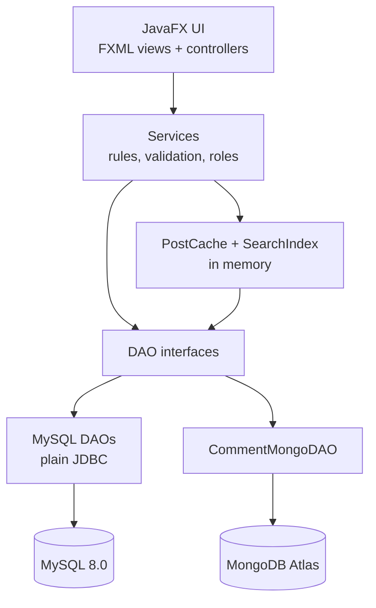

```
src/main/java/com/example/bloggingplatform/
├── Main.java            starts the app: splash screen, database check, main window
├── config/              DBConnection (MySQL), MongoConnection (Atlas)
├── model/               POJOs: User, Post, Comment, Review, Tag, Page, PostFilter, PostSort, CacheStats …
├── dao/                 interfaces: UserDAO, PostDAO, CommentDAO, TagDAO, ReviewDAO, ReportDAO
│   ├── impl/            MySQL versions with PreparedStatement
│   └── mongo/           CommentMongoDAO (MongoDB version of CommentDAO)
├── validations/         one validator per subject + Validation (collects field errors)
├── service/             AuthService, UserService, PostService, CommentService, ReviewService,
│                        TagService, ReportService, Session, AppContext (wires everything)
├── cache/               PostCache, SearchIndex
├── algorithms/          MergeSort, BinarySearch
├── controller/          one controller per screen + shared helpers
└── util/                PasswordHasher (PBKDF2) and UI helpers
```

---

## 3. User stories and how each one is met

Each story below lists its acceptance criteria. Every criterion has a short explanation and
proof: a screenshot from the running app, or the code or output that does it.

### Epic 1: Database design and modeling

#### User Story 1.1: conceptual, logical and physical models

> *As a database designer, I want to create conceptual, logical, and physical database models so
> that the data structure of the blogging platform is efficient and scalable.*

| Acceptance criterion | How it is met | Proof |
|----------------------|---------------|-------|
| Conceptual ERD or NoSQL schema includes all major entities and relationships | ERD with the 5 entities (users, posts, comments, tags, reviews) and the `post_tags` link table; a MongoDB schema for comments and reviews | ERD below; [`database-design.md` §3](docs/database-design.md); [`mongo-schema.js`](docs/nosql/mongo-schema.js) |
| Logical model defines attributes, primary/foreign keys and relationships | One table per entity with every attribute, its key and its relationship (1-to-many, many-to-many) | [`database-design.md` §4](docs/database-design.md) |
| Physical model includes SQL data types, constraints and normalization (3NF) | Exact types (`INT UNSIGNED`, `VARCHAR(200)`, `ENUM`, `DATETIME`), constraints and InnoDB. Each table is checked against 1NF, 2NF and 3NF | [`01_schema.sql`](docs/sql/01_schema.sql), [`database-design.md` §5-6](docs/database-design.md) |


```sql
CREATE TABLE posts (
    post_id    INT UNSIGNED NOT NULL AUTO_INCREMENT,
    author_id  INT UNSIGNED NOT NULL,
    title      VARCHAR(200) NOT NULL,
    content    TEXT         NOT NULL,
    status     ENUM('DRAFT', 'PUBLISHED') NOT NULL DEFAULT 'DRAFT',
    created_at DATETIME     NOT NULL DEFAULT CURRENT_TIMESTAMP,
    ...
    PRIMARY KEY (post_id),
    CONSTRAINT fk_posts_author FOREIGN KEY (author_id) REFERENCES users (user_id) ON DELETE CASCADE,
    CONSTRAINT uq_posts_author_title UNIQUE (author_id, title)
);
```

**In short:**
- Every fact is stored once: an author's name lives only in `users`, and posts point to it with
  `author_id`. That is 3NF.
- Posts and tags are many-to-many, so a small `post_tags` table joins them.

#### User Story 1.2: indexes and relationships

> *As a database administrator, I want to define indexes and relationships so that queries and
> lookups run efficiently while maintaining data integrity.*

| Acceptance criterion | How it is met | Proof |
|----------------------|---------------|-------|
| Appropriate primary and foreign keys defined | A primary key on all 6 tables; 7 foreign keys | output below |
| Indexes on frequently queried columns (post title, author ID, tag name) | `idx_posts_title (title)`, `idx_posts_author_created (author_id, created_at)`, `uq_tags_name (name)`, plus `idx_posts_status_created` for Discover | `01_schema.sql`, output below |
| Referential integrity enforced | Foreign keys with `ON DELETE CASCADE`, UNIQUE keys (username, email, one review per user and post) and CHECK rules (rating 1-5) | output below, `DAOIntegrationTest` |

```sql
INDEX idx_posts_status_created (status, created_at),    -- published posts, newest first (Discover)
INDEX idx_posts_author_created (author_id, created_at), -- one author's posts (My posts)
INDEX idx_posts_title (title)                           -- posts in title order
```

**Proof:** MySQL's own catalogue (`information_schema`), queried on the real database:

```
01 the 6 tables exist (users, posts, tags, post_tags, comments, reviews)  ->  PASS
02 every table has a primary key  ->  PASS
03 the 7 foreign keys exist and all are ON DELETE CASCADE  ->  PASS
04 unique keys: username, email, author+title, tag name, one review per user and post  ->  PASS
05 CHECK constraints: username length, rating 1-5  ->  PASS
06 index on post title (idx_posts_title)  ->  PASS
07 index starting with author ID (idx_posts_author_created)  ->  PASS
08 index on tag name (uq_tags_name)  ->  PASS
09 index for published posts by date (idx_posts_status_created)  ->  PASS
10 all tables use InnoDB (needed for foreign keys and transactions)  ->  PASS
11 no orphans: every comment, review and tag link points to an existing post  ->  PASS
12 every rating is between 1 and 5  ->  PASS
```

`DAOIntegrationTest` also tests the rules in action, on the real database:
- a second identical username is rejected;
- a rating of 9 is rejected;
- a comment on a missing post is rejected;
- deleting a post removes its comments and reviews.

**In short:**
- Deleting a post also deletes its comments, reviews and tag links, so nothing is left pointing
  at a post that no longer exists.
- The indexes make lookups fast: see Epic 4.

---

### Epic 2: Data access and CRUD operations

#### User Story 2.1: manage posts and comments

> *As a blogger, I want to add, update, and delete blog posts and comments through a JavaFX
> interface so that I can manage my content easily.*

| Acceptance criterion | How it is met | Proof |
|----------------------|---------------|-------|
| All CRUD operations functional via the JavaFX interface | Posts: create, edit, publish, delete. Comments and reviews: add, edit, delete. Admins also manage users and tags. Each table row has view (black), edit (orange) and delete (red) buttons; "New" is green | screenshots below |
| Input validation and user feedback | Every field is checked: email regex; password with a letter, a number and a symbol, at least 6 characters; title 3-200 characters… Problems appear in **red** under the field; success shows a toast | screenshots below |
| Database constraints prevent duplicates or invalid entries | UNIQUE keys stop a second username, email, title per author, tag or review; CHECK stops a rating outside 1-5. The services check first, so the user sees a clear message | `DAOIntegrationTest`, `DaoException` |

| An author's posts (edit / publish / delete per row) | Writing a post in a pop-up |
|---|---|
| 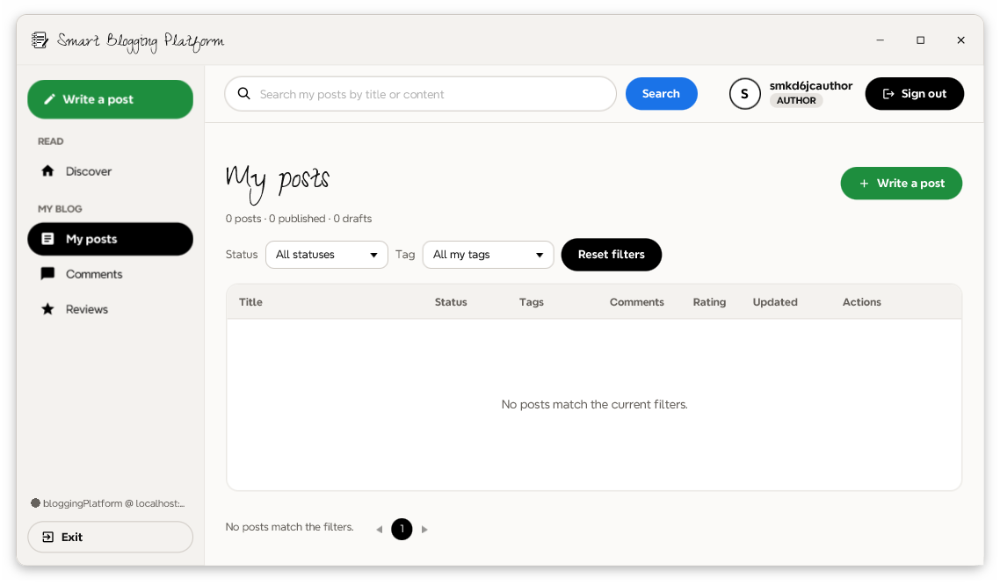 | 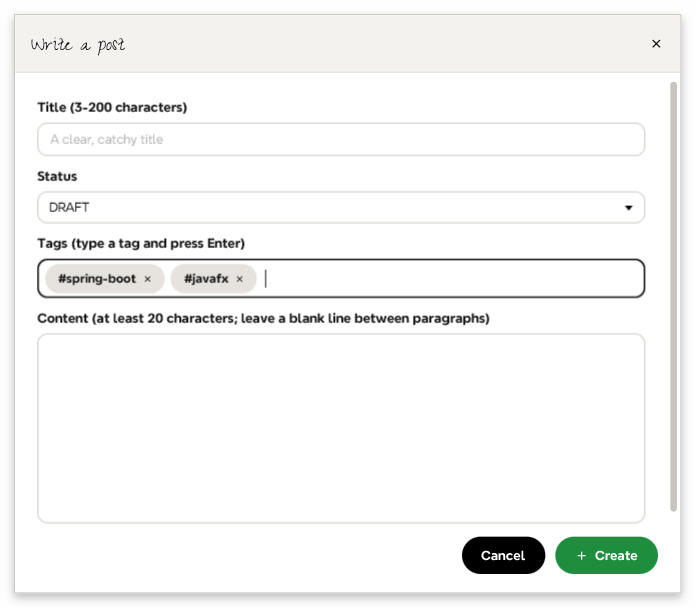 |

| Validation errors shown in red | Adding a comment |
|---|---|
| 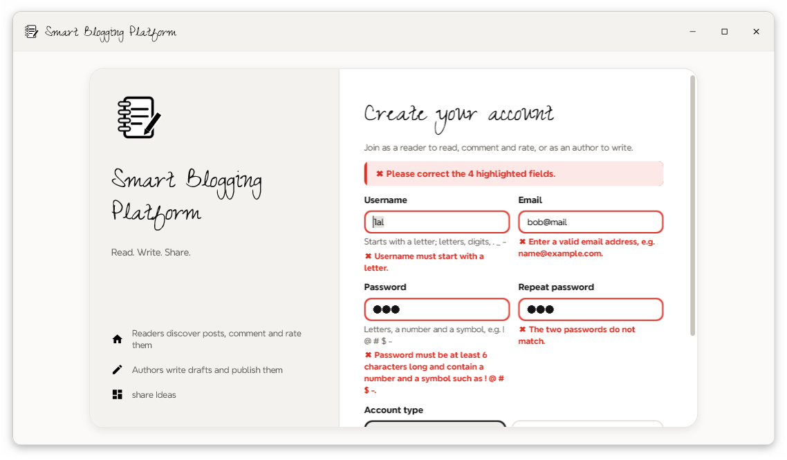 | 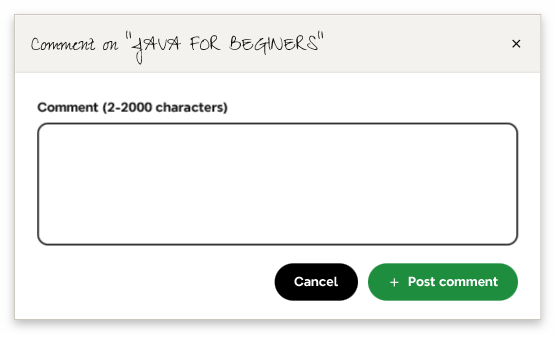 |

The password rule, as an example of validation:

```java
if (value.codePoints().noneMatch(Character::isLetter))  missing.add("a letter");
if (value.codePoints().noneMatch(Character::isDigit))   missing.add("a number");
if (value.codePoints().allMatch(Character::isLetterOrDigit)) missing.add("a symbol such as ! @ # $ -");
```

Deleting always asks first:

```java
if (confirmDelete("\"" + post.getTitle() + "\"", "Its comments, reviews and tag links are deleted too.")
        && perform("Post deleted.", () -> app.posts().delete(post.getId()))) { ... }
```

**In short:**
- Forms never close with bad input: every problem is listed in red next to its field.
- If the database still refuses something (for example, two people take the same username at
  the same moment), the MySQL error is turned into plain words such as "A record with the same
  value already exists."

#### User Story 2.2: view and search posts

> *As a reader, I want to view and search for blog posts and their details so that I can explore
> content of interest.*

| Acceptance criterion | How it is met | Proof |
|----------------------|---------------|-------|
| Post listings dynamically retrieved from the database | The Discover cards and the post tables are loaded from MySQL; the reading view shows the post with its comments and ratings | screenshots below |
| Pagination, filters and search | 6 cards per page with a page bar; filters by tag and author; a search bar; tables page with `LIMIT ? OFFSET ?` | screenshots below |
| Parameterized queries via JDBC or NoSQL driver | Every SQL statement is a `PreparedStatement` with `?` values; the MongoDB DAO uses driver filters | code below |

| Reading a post with ratings and comments | Search results |
|---|---|
| 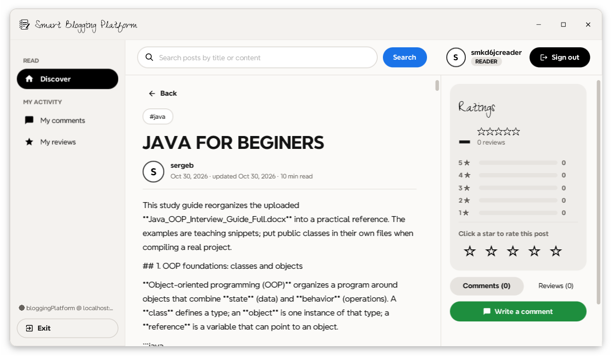 |  |

```java
// PostDAOImpl: values are never pasted into the SQL text
String sql = SELECT_POSTS + where(filter, values) + " ORDER BY p.created_at DESC, p.post_id DESC LIMIT ? OFFSET ?";
try (Connection conn = DBConnection.getConnection();
     PreparedStatement ps = conn.prepareStatement(sql)) {
    for (int i = 0; i < values.size(); i++) {
        ps.setObject(i + 1, values.get(i));
    }
    ...
}
```

**In short:** because typed text only ever goes into a `?` placeholder, searching for
`' OR '1'='1` finds nothing instead of breaking the query; a test proves it.

---

### Epic 3: Searching, sorting and optimization

#### User Story 3.1: fast search by keyword, tag or author

> *As a reader, I want to search for posts quickly by keyword, tag, or author so that I can find
> relevant articles efficiently.*

| Acceptance criterion | How it is met | Proof |
|----------------------|---------------|-------|
| Case-insensitive search | Words are stored and searched in lower case, so `JAVA`, `Java` and `java` give the same posts. One box finds words in the title, content, tags and author name; a word can be typed partly (`ind` finds "index") | screenshots below, `SearchIndexTest` |
| Indexing or hashing improves search performance | An **inverted index**: a `HashMap` from every word to the posts that contain it | code below |
| Performance improvements documented | Index vs checking every post on 10,000 posts: **134× to 3,456× faster** | table below (`PerformanceTimingsTest`) |

| `JAVA` in capitals finds Java posts | `carol` finds posts by author name |
|---|---|
| 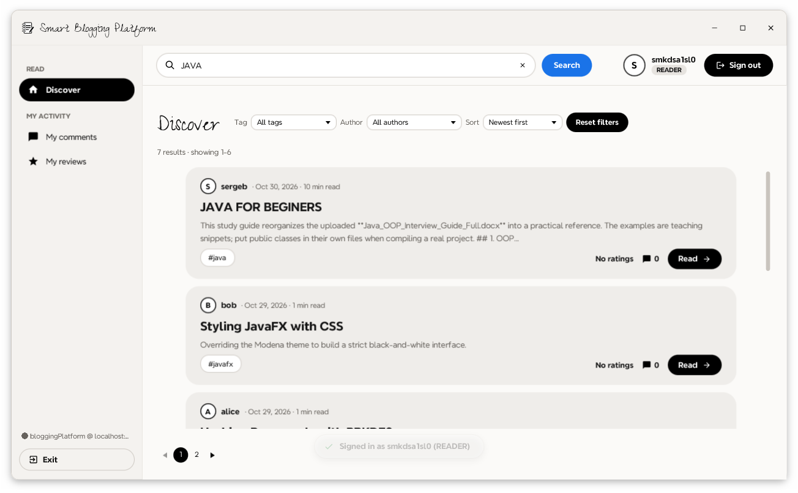 | 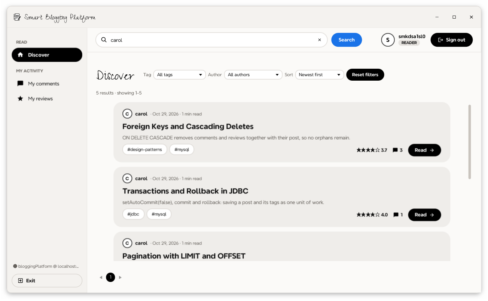 |

```java
// cache/SearchIndex: word → ids of the posts that contain it (built once per cache load)
for (Post post : posts) {
    for (String word : words(textOf(post))) {          // lower-case words of title, content, tags, author
        if (!postsByWord.containsKey(word)) {
            postsByWord.put(word, new HashSet<>());
        }
        postsByWord.get(word).add(post.getId());
    }
}
```

| Query (10,000 posts) | Check every post | Search index | Faster |
|---|---:|---:|---:|
| `w7x` | 19,061 µs | 50.8 µs | 375× |
| `w1234x` | 15,216 µs | 27.8 µs | 548× |
| `w42x w99x` (both words) | 14,498 µs | 108.0 µs | 134× |
| a word no post has | 12,371 µs | 3.6 µs | 3,456× |

**In short:**
- Like the index at the back of a book: instead of reading every post, the app looks the word up
  and gets the list of posts straight away.
- A test checks that the index finds exactly the same posts as reading every one.

#### User Story 3.2: caching and sorting

> *As a developer, I want to implement caching and sorting so frequently accessed posts are
> retrieved faster.*

| Acceptance criterion | How it is met | Proof |
|----------------------|---------------|-------|
| In-memory caching using Maps or Lists | `PostCache`: published posts in a `List` (newest first) and a `HashMap` by id, loaded once from MySQL | code below |
| Sorting/search algorithms applied | Hand-written **merge sort** orders Discover (Newest, Oldest, Title A-Z, Top rated); **binary search** finds words typed partly | screenshot and code below |
| Cache invalidation ensures consistency | Every change to a post, or to what a post shows (comments, ratings, tags, author name), calls `cache.clear()`; the next read reloads | `PostCacheTest` (a test per change), `CacheIntegrationTest` on MySQL |

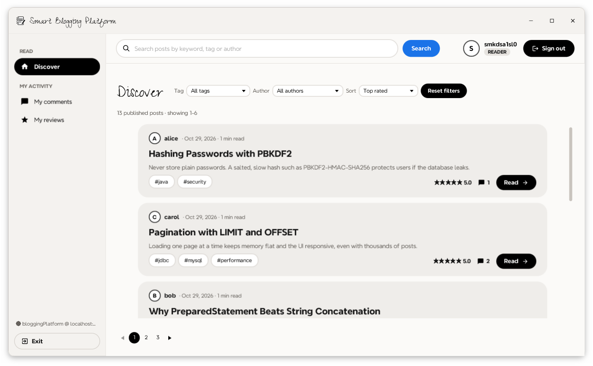

```java
// cache/PostCache: the first read loads from MySQL (miss); later reads use memory (hit)
private void loadIfEmpty() {
    if (published != null) {
        hits++;
        return;
    }
    misses++;
    ... load the published posts, MergeSort them newest first, build byId and the SearchIndex
}

// service/CommentService: a new comment changes a post's comment count → empty the cache
int id = comments.addComment(new Comment(0, postId, writer, text));
cache.clear();
```

```java
// algorithms/BinarySearch: first word >= key in a sorted list, halving the range each step (O(log n))
while (low < high) {
    int middle = (low + high) / 2;
    if (sorted.get(middle).compareTo(key) < 0) low = middle + 1;
    else high = middle;
}
```

| Operation (real data) | MySQL every time | Cache hit | Faster |
|---|---:|---:|---:|
| Discover, first page | 38,975 µs | 28.0 µs | 1,394× |
| Open one post | 12,296 µs | 0.5 µs | 27,324× |

**In short:**
- The most-read screen no longer asks the database every time.
- Because the cache is emptied on every relevant change, a new comment or rating shows up
  straight away. Stale data is never shown.

---

### Epic 4: Performance and query optimization

#### User Story 4.1: before / after performance report

> *As an analyst, I want performance reports comparing pre- and post-optimization queries.*

| Acceptance criterion | How it is met | Proof |
|----------------------|---------------|-------|
| Query execution times recorded before/after optimization | A separate benchmark database with 100,000 posts; the app's own queries timed without and with the indexes (median of 15 runs after 3 warm-ups), with MySQL's `EXPLAIN ANALYZE` plans | `QueryBenchmarkTest`, results below |
| Indexing and caching demonstrate measurable gains | Indexes: Discover page **179× faster**. Cache: about **1,400×** faster than MySQL. Cache statistics on the dashboard | results and screenshot below |

Run it with `.\mvnw.cmd test -Dtest=QueryBenchmarkTest -Dbenchmark=true` (about a minute; the real
database is not touched):

| Query (100,000 posts) | No index | With index | Faster |
|-------|---------:|-----------:|-------:|
| Discover: first page, newest first | 307.39 ms | 1.72 ms | **178.9×** |
| Discover: count for the page numbers | 58.98 ms | 43.05 ms | 1.4× |
| My posts: one author, newest first | 7.42 ms | 1.45 ms | **5.1×** |
| Drop-down: posts in title order | 54.56 ms | 0.77 ms | **71.3×** |
| Keyword search `LIKE '%…%'` (control) | 506.54 ms | 635.23 ms | 0.8× |

What the index changed, according to MySQL's own plan:

```
before: Table scan on p (100,000 rows) → Sort (80,000 rows) → Limit 6        465 ms
after:  Index lookup on p using idx_posts_status_created (reverse) → 6 rows   0.1 ms
```

- **Why it works:** the index already keeps the published posts in date order, so MySQL reads 6
  entries instead of sorting 80,000 rows.
- **The `LIKE` exception:** a `LIKE '%word%'` search cannot use any index, and through the new
  index it even got slower (80% of posts are published). That is why Discover's search uses the
  in-memory index from Epic 3 instead.
- **The cost:** on 100,000 posts the three indexes use 8.5 MB, next to 39.6 MB for the table
  itself, and each saved post updates three more small trees. A blog reads far more than it
  writes, so this is a good trade.

**Analytics:** the admin Dashboard shows top-rated posts, most-commented posts, posts per tag,
activity per author and the live **cache statistics** (hit rate, hits, misses, load time).

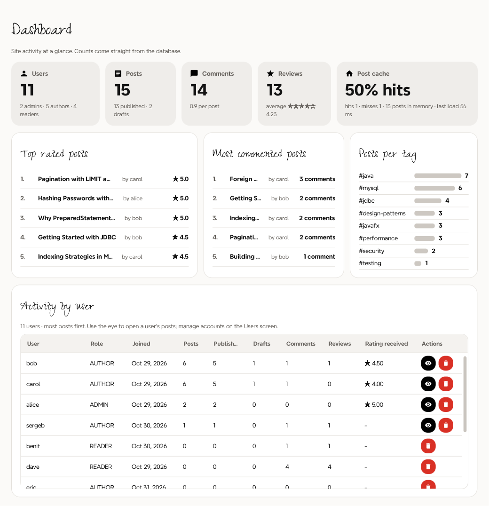

#### User Story 4.2: comments and reviews in NoSQL

> *As a developer, I want to store comments/reviews in NoSQL format for flexibility.*

| Acceptance criterion | How it is met | Proof |
|----------------------|---------------|-------|
| NoSQL schema defined for unstructured data | MongoDB collections `comments`, `reviews` and `counters` with `$jsonSchema` validators, indexes, sample documents and example queries | [`docs/nosql/mongo-schema.js`](docs/nosql/mongo-schema.js) |
| Justification provided | Comments and reviews are free text with optional parts (replies, edits) that would need new tables in MySQL; see below | below |
| Optional SQL vs NoSQL comparison | Comparison table below. `CommentMongoDAO` implements the same `CommentDAO` interface, and the unchanged `CommentService` passes 4 tests on MongoDB Atlas | `CommentMongoIntegrationTest` |

A comment as one MongoDB document (no join needed to show it):

```js
{
  _id: 1, postId: 20,
  post: { title: "Getting Started with JDBC", authorId: 25 },   // copied in when saved
  user: { id: 27, username: "dave" },
  content: "Clear introduction, thanks!",
  createdAt: ISODate("2026-10-29T09:12:00Z"),
  replies: [ { user: { id: 25, username: "bob" }, content: "Glad it helped!", createdAt: ISODate("...") } ]
}
```

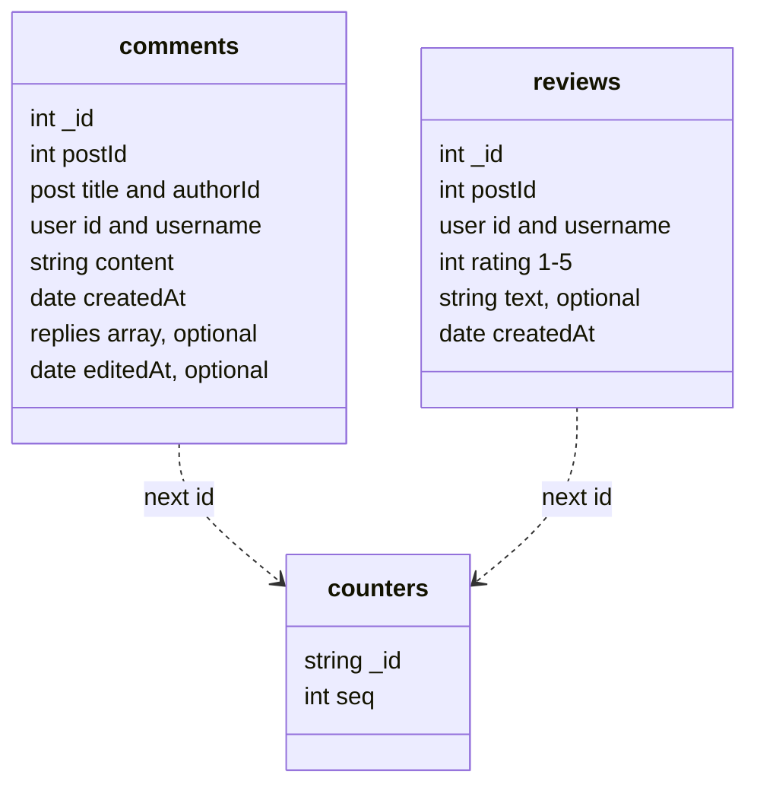

**Why this design:**

| Choice | Decision | Why |
|--------|----------|-----|
| Comments inside the post document? | **No**, a separate collection linked by `postId` | Comments grow without limit (a document is capped at 16 MB), and "comments by a user" is read across posts |
| Post title and writer name inside each comment? | **Yes**, copied in | Each comment screen becomes one query with no join; the price is updating the copies on a rename |
| Replies inside their comment? | **Yes**, an array | Always read with their comment, few, and belonging to nothing else |
| Rules | `$jsonSchema` validator + indexes | Same limits as MySQL and the Java validators (content 2-2,000 chars, rating 1-5); a unique index keeps one review per user and post |

**SQL vs NoSQL:**

| | MySQL | MongoDB |
|---|-------|---------|
| Schema | Fixed columns; a new field needs `ALTER TABLE` | Flexible: optional fields and nested arrays per document, rules through `$jsonSchema` |
| Relationships | Foreign keys, joins, `ON DELETE CASCADE` | Ids plus copied data; no foreign keys or cascade |
| A post's comments | Join three tables | One query on one collection |
| Consistency | ACID transactions over many tables | Atomic per document; copies can go stale |
| Speed here | 1-2 ms on the local server | median 99 ms per query to the Atlas cloud (network) |

```java
// dao/mongo/CommentMongoDAO: same method as the MySQL DAO, MongoDB query instead of SQL
@Override
public List<Comment> getCommentsByPost(int postId) {
    return find(Filters.eq("postId", postId), "Could not load the comments on this post.");
}
```

**In short:**
- A comment's replies and optional fields fit naturally inside one document, with no new tables.
- MySQL stays the main database, because comment counts, ratings and cascade deletes are all
  joined with posts. The DAO interface makes switching a one-line change in `AppContext`.

---

### Epic 5: Reporting and documentation

#### User Story 5.1: full documentation

> *As a contributor, I want full documentation for maintainability.*

| Acceptance criterion | How it is met | Proof |
|----------------------|---------------|-------|
| ERDs or schema diagrams included | The ERD, the MongoDB document diagram and the architecture diagram | [`docs/db erd.png`](docs/db%20erd.png), [§2](#2-architecture), [US 4.2](#user-story-42-comments-and-reviews-in-nosql) |
| SQL/NoSQL scripts provided | The MySQL schema and the MongoDB schema script | [`docs/sql/01_schema.sql`](docs/sql/01_schema.sql), [`docs/nosql/mongo-schema.js`](docs/nosql/mongo-schema.js) |
| README with setup instructions | This file: setup, architecture, every user story with proof, all screenshots | [§1 Quick start](#1-quick-start) |

The full database design is in [`docs/database-design.md`](docs/database-design.md), and
[`phases.md`](phases.md) tracks every requirement and the file that meets it.

---

## 4. Testing

```bash
.\mvnw.cmd test                                             # 188 tests (the benchmark is skipped)
.\mvnw.cmd test -Dtest=QueryBenchmarkTest -Dbenchmark=true   # the 100,000-post benchmark (about a minute)
```

| Kind | Examples | What they prove |
|------|----------|-----------------|
| Unit (in-memory fake DAOs) | `PostServiceTest`, `AccessRulesTest`, `PostCacheTest`, validators | every rule, role and edge case without a database |
| Algorithms | `MergeSortTest`, `BinarySearchTest`, `SearchIndexTest` | correct on edge cases, same result as Java's own sort |
| MySQL integration | `DAOIntegrationTest`, `CacheIntegrationTest` | real SQL, constraints, cascades, cache invalidation end to end |
| MongoDB integration | `CommentMongoIntegrationTest` | the comment service working on Atlas |
| Timings | `PerformanceTimingsTest`, `QueryBenchmarkTest` | the numbers in this README |

---

## 5. All screenshots

### Starting and signing in

| Splash screen | Sign in | Create an account |
|---|---|---|
|  | 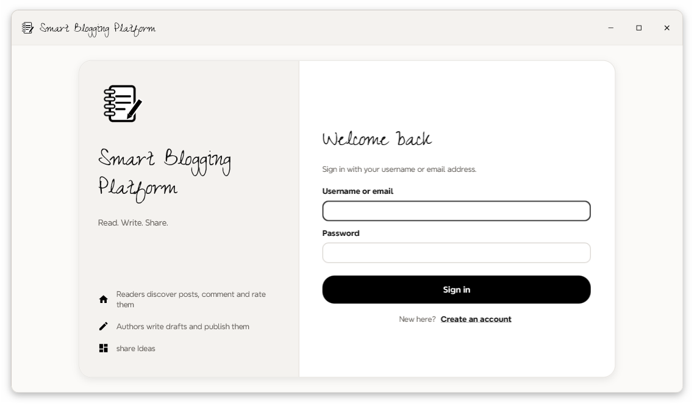 |  |

| Validation while typing | Validation after submitting | Fixing the fields |
|---|---|---|
| 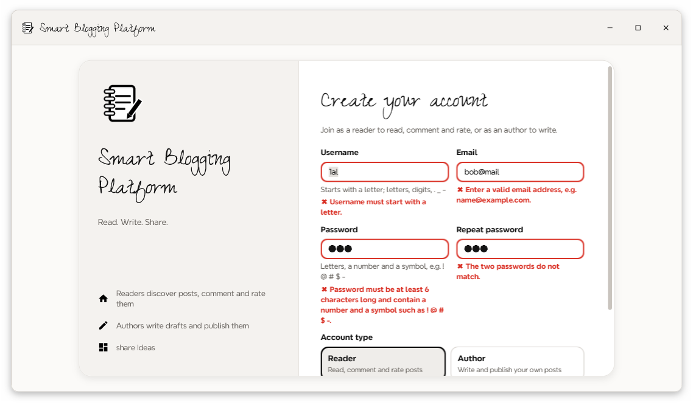 |  | 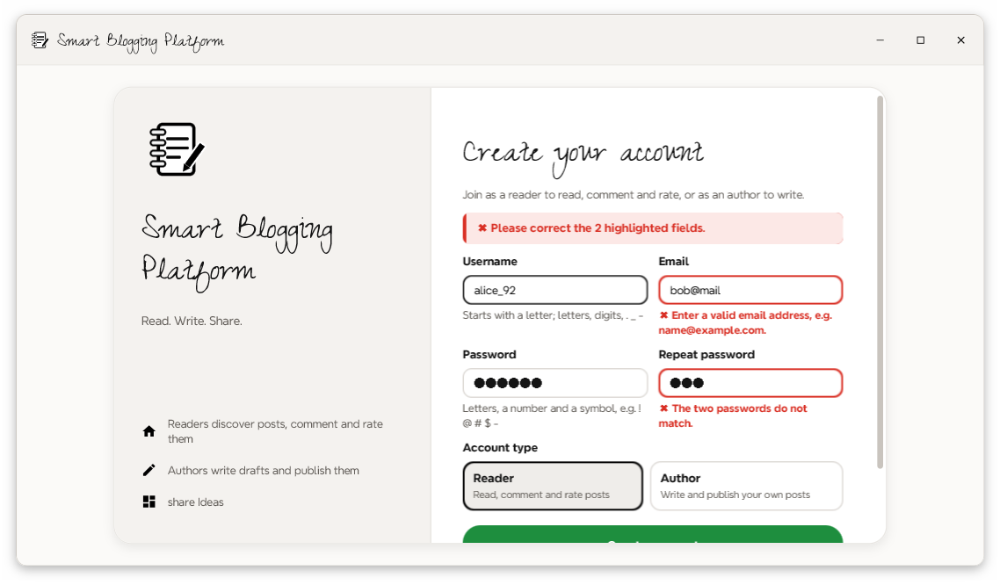 |

### Reading and searching (Reader)

| Discover | Discover (reader view) |
|---|---|
|  | 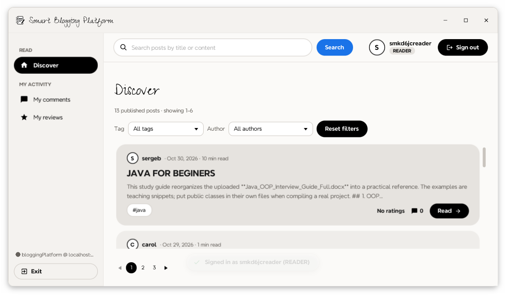 |

| Search "java" | Search in capitals "JAVA" |
|---|---|
|  |  |

| Part of a word ("ind") | By author ("carol") |
|---|---|
| 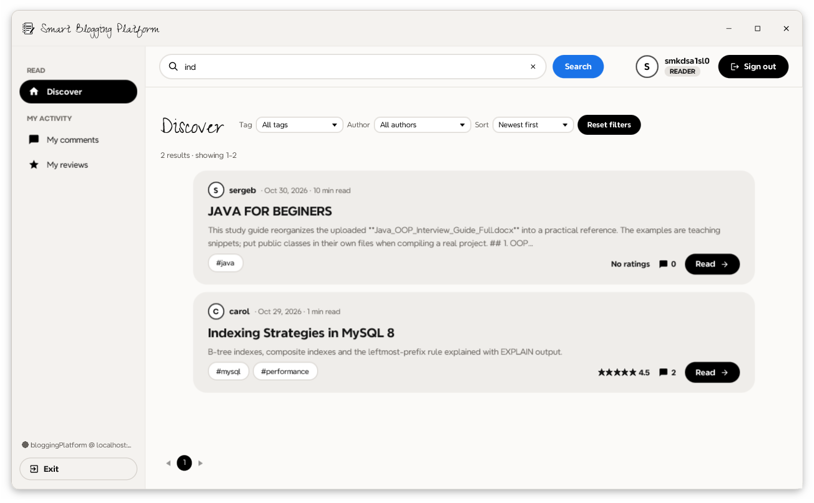 |  |

| Sorted by top rated | Reading a post |
|---|---|
|  |  |

| Rating a post | Adding a comment | My comments |
|---|---|---|
| 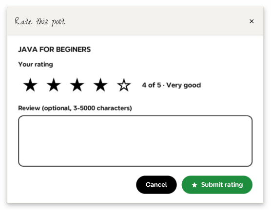 |  | 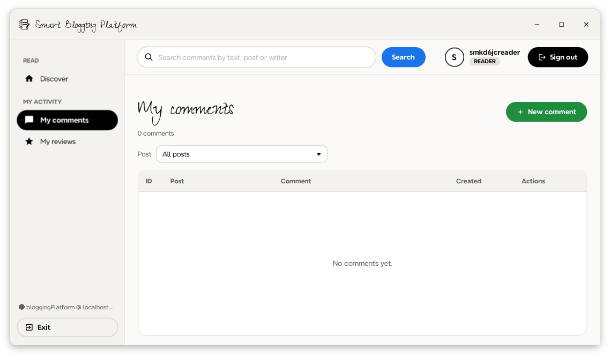 |

### Writing (Author)

| My posts | Writing a post |
|---|---|
|  |  |

| Post validation while typing | Post validation after submitting |
|---|---|
| 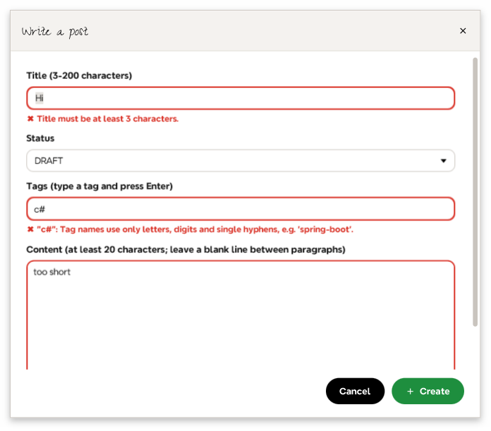 | 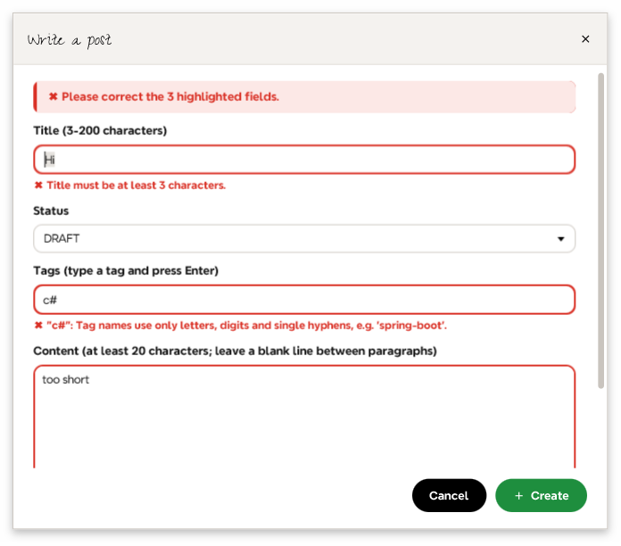 |

### Managing (Admin)

| Writing for any author | All posts | Users |
|---|---|---|
| 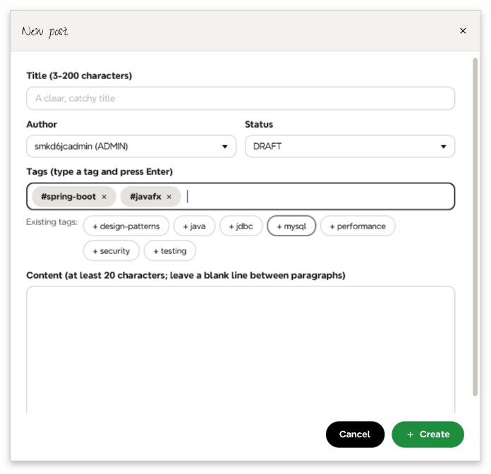 | 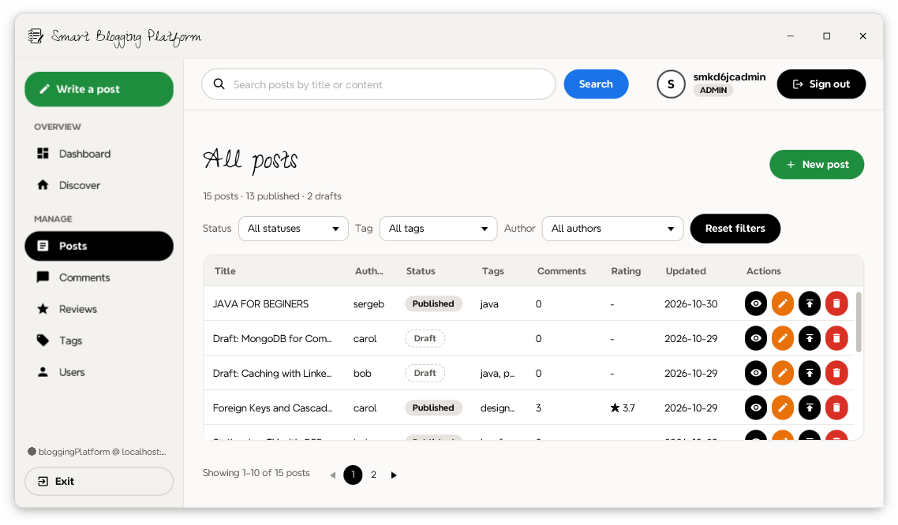 | 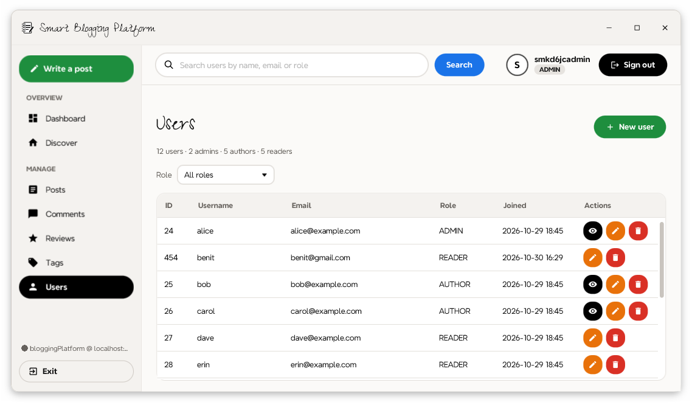 |

| Dashboard | Dashboard (full page) |
|---|---|
| 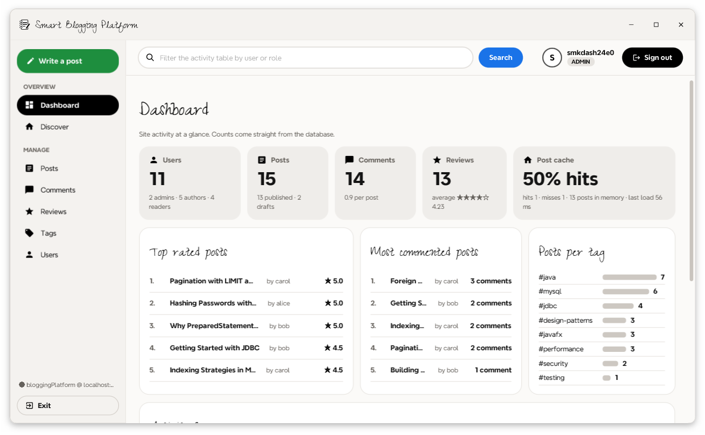 |  |
