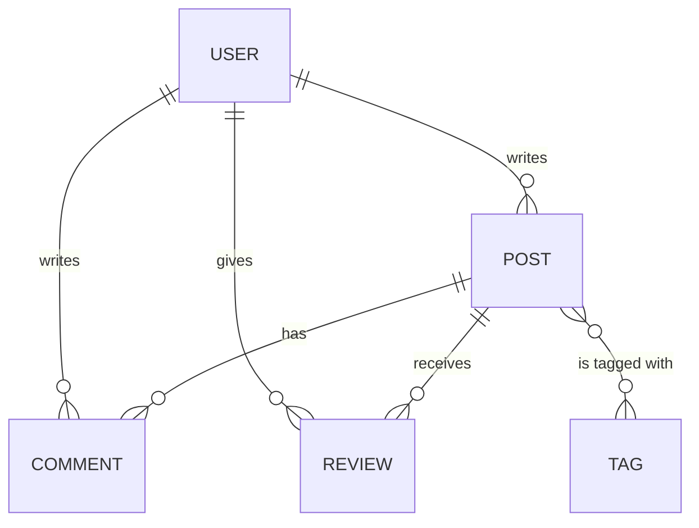
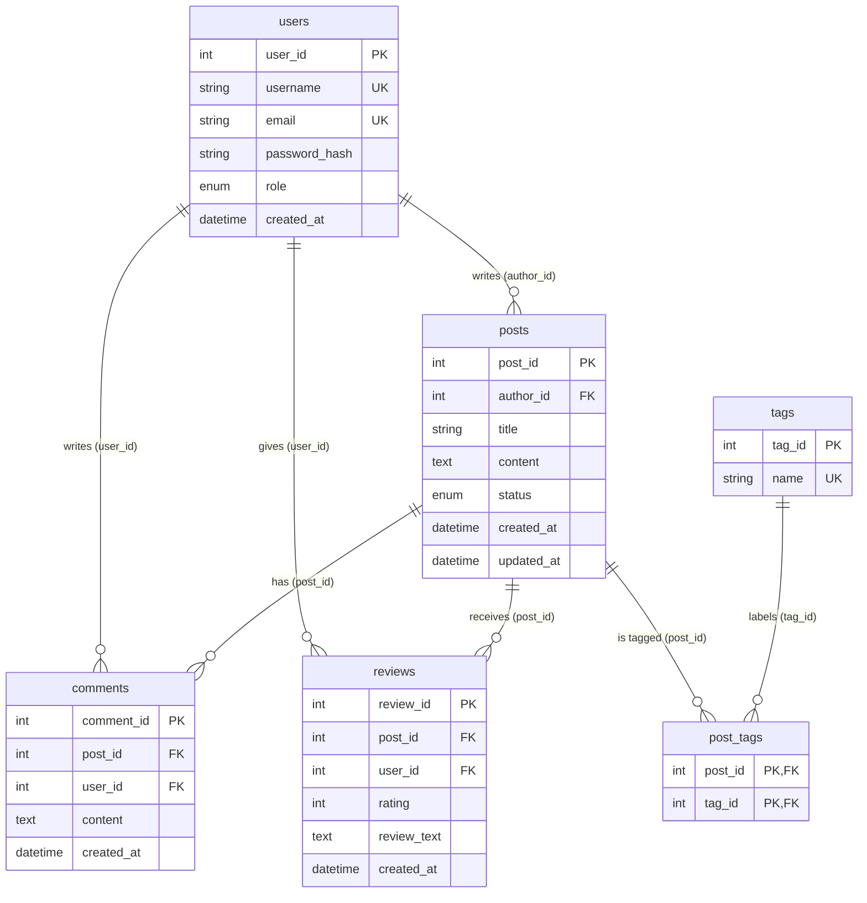

# Database Design Document — Smart Blogging Platform

| | |
|---|---|
| **Phase** | 1 — Database Design & Modeling ([phases.md](../phases.md)) |
| **User stories** | 1.1 (conceptual, logical, physical models), 1.2 (keys, indexes, integrity) |
| **DBMS** | MySQL 8.0 (InnoDB, `utf8mb4`) |
| **Scripts** | [`sql/01_schema.sql`](sql/01_schema.sql) (MySQL) · [`nosql/mongo-schema.js`](nosql/mongo-schema.js) (MongoDB) |
| **ERD** | [`db erd.png`](db%20erd.png) |

---

## 1. Purpose and Scope

This document defines the persistence layer for the Smart Blogging Platform: who the
users are, what they write (posts), how readers respond (comments and reviews) and how
content is classified (tags). It moves from the **conceptual** model (what the business
talks about) to the **logical** model (attributes and keys, DBMS-independent) to the
**physical** model (MySQL types, constraints and indexes), and shows that the result is in
**Third Normal Form**.

Out of scope for Phase 1: application code (Phase 2), in-memory caching and search
structures (Phase 3), benchmark data and the NoSQL model for comments/reviews (Phase 4).

## 2. Requirements Coverage

| Acceptance criterion | Where it is met |
|----------------------|-----------------|
| **1.1** Conceptual ERD includes all major entities and relationships | [§3](#3-conceptual-model), [`db erd.png`](db%20erd.png) |
| **1.1** Logical model defines attributes, primary/foreign keys and relationships | [§4](#4-logical-model) |
| **1.1** Physical model includes SQL data types, constraints and normalization (3NF) | [§5](#5-normalization-1nf--3nf), [§6](#6-physical-model), [`01_schema.sql`](sql/01_schema.sql) |
| **1.2** Appropriate primary and foreign keys defined | [§4](#4-logical-model), [§8](#8-referential-integrity--constraints) |
| **1.2** Indexes on frequently queried columns (post title, author ID, tag name) | [§7](#7-index-design) |
| **1.2** Referential integrity enforced | [§8](#8-referential-integrity--constraints), tested by `DAOIntegrationTest` |

---

## 3. Conceptual Model


### 3.1 Entities

| Entity | Description |
|--------|-------------|
| **User** | A registered account. Has a role: `ADMIN` (moderates), `AUTHOR` (writes posts), `READER` (comments and reviews). |
| **Post** | A blog article written by one user, with a status: `DRAFT` (only the author and admins see it) or `PUBLISHED`. |
| **Comment** | A free-text reply by a user on a post. A post can have many; a user can write many. |
| **Review** | A 1–5 star rating with optional text that a user gives a post — at most one per user per post. |
| **Tag** | A label (e.g. `java`, `mysql`) used to classify and find posts. |

### 3.2 Relationships

| Relationship (ERD label) | Cardinality | Meaning |
|--------------------------|-------------|---------|
| User **writes** Post | 1 : N | Every post has exactly one author; a user may write zero or many posts. |
| User **writes** Comment | 1 : N | Every comment has exactly one writer. |
| User **gives** Review | 1 : N | Every review is given by exactly one user. |
| Post **has** Comment | 1 : N | Every comment belongs to exactly one post. |
| Post **receives** Review | 1 : N | Every review is about exactly one post. |
| Post **is tagged** with Tag | M : N | A post has zero or many tags; a tag labels zero or many posts. Resolved by the associative entity **PostTag** (`is tagged` 1:N + `labels` 1:N). |

Entity-level view (no attributes):



### 3.3 Business rules captured by the model

1. Usernames and email addresses are unique (case-insensitive).
2. An author cannot have two posts with the same title.
3. A user can review a given post only once; the rating is an integer from 1 to 5.
4. A tag name is unique and stored as a lower-case slug.
5. A tag is attached to a given post at most once.
6. Removing a post removes its comments, reviews and tag links; removing a user removes
   everything they authored (see [§8](#8-referential-integrity--constraints)).

---

## 4. Logical Model

The M:N relationship between posts and tags becomes the junction table `post_tags`.
All other relationships are 1:N and are implemented by a foreign key on the "many" side.
Surrogate integer keys are used for every entity; natural keys (`username`, `email`,
`tags.name`, `(author_id, title)`, `(post_id, user_id)` for reviews) are kept as
**unique keys** (UK, also called alternate keys). In the ERD a key over two columns is marked
UK1 on both of them.



### 4.1 Relations

Notation: **PK** primary key · **FK** foreign key · **UK** unique (alternate) key · **UK1** unique together with the other UK1 column.

**users**(<u>user_id</u>, username, email, password_hash, role, created_at)

| Attribute | Key | Domain | Required | Notes |
|-----------|-----|--------|----------|-------|
| user_id | PK | positive integer | yes | surrogate, auto-generated |
| username | UK | text 3–50 chars | yes | unique, case-insensitive |
| email | UK | text ≤ 255, email format | yes | unique, case-insensitive |
| password_hash | | text ≤ 255 | yes | hash only, never the plain password |
| role | | {ADMIN, AUTHOR, READER} | yes | default READER |
| created_at | | date-time | yes | default now |

**posts**(<u>post_id</u>, *author_id* → users, title, content, status, created_at, updated_at)

| Attribute | Key | Domain | Required | Notes |
|-----------|-----|--------|----------|-------|
| post_id | PK | positive integer | yes | surrogate |
| author_id | FK → users.user_id, part of UK1 | positive integer | yes | the writer |
| title | part of UK1 (author_id, title) | text 1–200 chars | yes | not blank |
| content | | long text | yes | not blank |
| status | | {DRAFT, PUBLISHED} | yes | default DRAFT |
| created_at | | date-time | yes | default now |
| updated_at | | date-time ≥ created_at | yes | refreshed on every update |

**comments**(<u>comment_id</u>, *post_id* → posts, *user_id* → users, content, created_at)

| Attribute | Key | Domain | Required | Notes |
|-----------|-----|--------|----------|-------|
| comment_id | PK | positive integer | yes | surrogate |
| post_id | FK → posts.post_id | positive integer | yes | commented post |
| user_id | FK → users.user_id | positive integer | yes | comment writer |
| content | | text 1–2000 chars | yes | not blank |
| created_at | | date-time | yes | default now |

**reviews**(<u>review_id</u>, *post_id* → posts, *user_id* → users, rating, review_text, created_at)

| Attribute | Key | Domain | Required | Notes |
|-----------|-----|--------|----------|-------|
| review_id | PK | positive integer | yes | surrogate |
| post_id | FK → posts.post_id, part of UK1 | positive integer | yes | reviewed post |
| user_id | FK → users.user_id, part of UK1 | positive integer | yes | reviewer |
| rating | | integer 1–5 | yes | |
| review_text | | text ≤ 5000 chars | no | a rating without text is allowed |
| created_at | | date-time | yes | default now |

**tags**(<u>tag_id</u>, name)

| Attribute | Key | Domain | Required | Notes |
|-----------|-----|--------|----------|-------|
| tag_id | PK | positive integer | yes | surrogate |
| name | UK | lower-case slug ≤ 50 chars (`a-z`, `0-9`, `-`) | yes | unique |

**post_tags**(<u>*post_id*</u> → posts, <u>*tag_id*</u> → tags)

| Attribute | Key | Domain | Required | Notes |
|-----------|-----|--------|----------|-------|
| post_id | PK, FK → posts.post_id | positive integer | yes | identifying relationship |
| tag_id | PK, FK → tags.tag_id | positive integer | yes | identifying relationship |

`post_tags` is the only table whose foreign keys are part of its primary key (identifying
relationships). Comments and reviews have their own surrogate keys, so their relationships
to users and posts are non-identifying.

---

## 5. Normalization (1NF → 3NF)

### 5.1 Starting point

A naive single-table design would store everything about a post in one row:

| post_title | author_name | author_email | tags | comment_1 | commenter_1 | comment_2 | … | avg_rating |
|------------|-------------|--------------|------|-----------|-------------|-----------|---|------------|
| Indexing Strategies in MySQL 8 | bob | bob@example.com | databases, mysql, performance | The composite index … | carol | How does InnoDB … | … | 4.0 |

Problems: a list inside one column (`tags`), repeating column groups (`comment_n`),
author data repeated on every post (update anomaly), a post cannot exist without a
comment slot layout, and a stored aggregate (`avg_rating`) that drifts out of date.

### 5.2 First Normal Form — atomic values, no repeating groups

- `tags` list → one row per (post, tag) in **post_tags**, with tag names in **tags**.
- `comment_n` / `commenter_n` groups → one row per comment in **comments**.
- Reviews → one row per review in **reviews**.
- Every table has a primary key; every column holds a single value.

### 5.3 Second Normal Form — no partial dependency on part of a composite key

- Only **post_tags** has a composite primary key, and it has no non-key attributes, so no
  partial dependency is possible.
- **reviews** has the composite candidate key `(post_id, user_id)`; `rating`,
  `review_text` and `created_at` describe that specific user's review of that specific
  post — they depend on the whole key, not on `post_id` or `user_id` alone.
- `posts` has candidate key `(author_id, title)`; `content`, `status`, dates depend on the
  whole post, not on the author alone.

### 5.4 Third Normal Form — no transitive dependency

Functional dependencies per table (every determinant is a candidate key, so the schema is
in 3NF and also in BCNF):

| Table | Functional dependencies | Determinants are keys? |
|-------|-------------------------|------------------------|
| users | user_id → all; username → user_id; email → user_id | ✅ user_id, username, email |
| posts | post_id → all; (author_id, title) → post_id | ✅ post_id, (author_id, title) |
| comments | comment_id → all | ✅ |
| reviews | review_id → all; (post_id, user_id) → review_id | ✅ review_id, (post_id, user_id) |
| tags | tag_id → name; name → tag_id | ✅ |
| post_tags | (post_id, tag_id) → ∅ (all-key relation) | ✅ |

Transitive dependencies removed:

- `posts.author_name`/`author_email` would depend on `author_id`, not on `post_id`
  (`post_id → author_id → username`). Only `author_id` is stored; details live in `users`.
- `comments.post_title` or `comments.username` are likewise not stored.
- **Derived values are not stored**: comment count, review count, average rating and a
  post's tag list are computed with queries. If they ever need to be faster, Phase 3 can
  cache them in memory instead of denormalizing the tables.

### 5.5 Design decisions

| Decision | Alternative considered | Reason |
|----------|------------------------|--------|
| `ENUM` for `users.role` and `posts.status` | Lookup tables `roles`, `post_statuses` | Small, fixed sets that only change with a code release. An ENUM is a domain constraint, not a dependency, so 3NF is unaffected; it avoids a join on every listing. |
| Surrogate `INT` keys + natural alternate keys | Natural keys as PKs (e.g. `username`) | Users can change username/email without cascading updates; compact 4-byte FKs keep indexes small. |
| `post_tags` junction table | Comma-separated tags column | Required by 1NF; enables indexed "posts with tag X" lookups. |
| Reviews separate from comments | One table with nullable rating | Different rules (one review per user per post, mandatory rating 1–5) map cleanly onto separate constraints. |

---

## 6. Physical Model

**Engine:** InnoDB (transactions, row locking, foreign keys, clustered primary keys).
**Character set / collation:** `utf8mb4` / `utf8mb4_0900_ai_ci` — full Unicode (including
emoji) and case-/accent-insensitive comparisons, which gives case-insensitive `UNIQUE`
checks and searches without `LOWER()` calls.
**Minimum version:** MySQL 8.0.16 (CHECK constraints are enforced from this version).

### 6.1 Data types

| Table.column | MySQL type | Rationale |
|--------------|------------|-----------|
| *all* `*_id` | `INT UNSIGNED` | 0 – 4.29 billion; 4 bytes per key and FK |
| users.username | `VARCHAR(50)` | display handle |
| users.email | `VARCHAR(255)` | practical max email length |
| users.password_hash | `VARCHAR(255)` | fits SHA-256 hex (64) or bcrypt/argon2 strings |
| users.role | `ENUM('ADMIN','AUTHOR','READER')` | 1 byte, validated by MySQL |
| posts.title | `VARCHAR(200)` | indexed; short enough for a B-tree key |
| posts.content | `MEDIUMTEXT` | up to 16 MB — long articles |
| posts.status | `ENUM('DRAFT','PUBLISHED')` | 1 byte, validated by MySQL |
| comments.content | `TEXT` | up to 64 KB, limited to 2000 chars by CHECK |
| reviews.rating | `TINYINT UNSIGNED` | 1 byte, limited to 1–5 by CHECK |
| reviews.review_text | `TEXT NULL` | optional |
| tags.name | `VARCHAR(50)` | short label |
| `created_at`, `updated_at` | `DATETIME` | no 2038 limit and no time-zone conversion (unlike `TIMESTAMP`); `DEFAULT CURRENT_TIMESTAMP`, `updated_at` also `ON UPDATE CURRENT_TIMESTAMP` |

The complete DDL is in [`sql/01_schema.sql`](sql/01_schema.sql).

---

## 7. Index Design

InnoDB stores each table as a B+tree clustered on the primary key; every secondary index
stores the primary key as its row pointer. Indexes follow the **leftmost-prefix** rule: an
index on `(a, b)` serves filters on `a` and on `a AND b`, and can return rows ordered by `b`
for a fixed `a`.

| Index | Table (columns) | Type | Query it serves | Requirement |
|-------|-----------------|------|-----------------|-------------|
| `PRIMARY` | each table (`*_id`) | clustered B+tree, unique | fetch by id, FK targets | 1.2 PK |
| `uq_users_username` | users (username) | unique B-tree | login / profile lookup, duplicate prevention | 1.2, 2.1 |
| `uq_users_email` | users (email) | unique B-tree | login / registration check | 1.2, 2.1 |
| `idx_posts_title` | posts (title) | B-tree | `WHERE title = ?`, `title LIKE 'prefix%'`, `ORDER BY title` | **1.2 post title** |
| `ft_posts_title_content` | posts (title, content) | FULLTEXT (inverted index) | keyword search `MATCH … AGAINST` (a `LIKE '%word%'` cannot use a B-tree) | 3.1 keyword |
| `idx_posts_author_created` | posts (author_id, created_at) | B-tree | `WHERE author_id = ? ORDER BY created_at DESC` (author page); also backs `fk_posts_author` | **1.2 author ID**, 3.1 author |
| `uq_posts_author_title` | posts (author_id, title) | unique B-tree | prevents duplicate titles per author | 2.1 |
| `idx_posts_status_created` | posts (status, created_at) | B-tree | `WHERE status = 'PUBLISHED' ORDER BY created_at DESC LIMIT ?, ?` (home page, pagination) | 2.2 |
| `uq_tags_name` | tags (name) | unique B-tree | `WHERE name = ?` tag lookup | **1.2 tag name**, 3.1 tag |
| `PRIMARY` | post_tags (post_id, tag_id) | clustered, unique | tags of a post | 1.2 |
| `idx_post_tags_tag` | post_tags (tag_id) [+ post_id] | B-tree | posts with a tag (reverse direction of the junction) | 3.1 tag |
| `idx_comments_post_created` | comments (post_id, created_at) | B-tree | comments of a post in order; backs `fk_comments_post` | 2.2 |
| `idx_comments_user` | comments (user_id) | B-tree | comments by a user; backs `fk_comments_user` | 1.2 |
| `uq_reviews_post_user` | reviews (post_id, user_id) | unique B-tree | one review per user per post; reviews / average rating of a post | 1.2, 2.1 |
| `idx_reviews_user` | reviews (user_id) | B-tree | reviews by a user; backs `fk_reviews_user` | 1.2 |

Every foreign key column is the leftmost column of at least one index, so FK checks and
cascading deletes never scan a whole child table.

**What `01_schema.sql` creates today:**
- the primary and unique keys;
- the indexes MySQL makes for the foreign keys;
- since Phase 4, `idx_posts_status_created`, `idx_posts_author_created` and `idx_posts_title`
  (on an existing database, run the three `CREATE INDEX` statements once).

They are measured in the [README, User Story 4.1](../README.md#user-story-41-before--after-performance-report): Discover's first page is
179× faster on 100,000 posts. `ft_posts_title_content` was not created. Keyword search is served
by the Phase 3 in-memory search index instead, and the README explains why a
`LIKE '%word%'` cannot use these indexes.

**Trade-off:** each secondary index speeds reads but adds work to every `INSERT`/`UPDATE`
and uses disk. Indexes were only added for queries the application actually runs.
Phase 4 measures each of them by timing the same queries with the index dropped and
re-created on bulk data.

---

## 8. Referential Integrity & Constraints

### 8.1 Foreign keys

| Constraint | Child → Parent | ON DELETE | ON UPDATE | Reason |
|------------|----------------|-----------|-----------|--------|
| `fk_posts_author` | posts.author_id → users.user_id | CASCADE | CASCADE | Deleting an account removes the author's posts (and, transitively, their comments, reviews and tag links). |
| `fk_comments_post` | comments.post_id → posts.post_id | CASCADE | CASCADE | A comment has no meaning without its post. |
| `fk_comments_user` | comments.user_id → users.user_id | CASCADE | CASCADE | Deleting an account removes the user's comments. |
| `fk_reviews_post` | reviews.post_id → posts.post_id | CASCADE | CASCADE | A review has no meaning without its post. |
| `fk_reviews_user` | reviews.user_id → users.user_id | CASCADE | CASCADE | Deleting an account removes the user's reviews. |
| `fk_post_tags_post` | post_tags.post_id → posts.post_id | CASCADE | CASCADE | Link rows disappear with the post. |
| `fk_post_tags_tag` | post_tags.tag_id → tags.tag_id | CASCADE | CASCADE | Deleting a tag un-tags posts but keeps the posts. |

`ON UPDATE CASCADE` is a safety net only: surrogate keys are never updated by the
application. Rows that reference a non-existent parent are rejected (MySQL error 1452).

*Alternative considered:* `ON DELETE RESTRICT` plus a soft-delete flag on users, which keeps
content after an account is removed. Hard cascading deletes were chosen to keep Phase 2 CRUD
simple and guarantee no orphans; the switch is a one-line change per FK if needed.

### 8.2 Constraint catalogue

| Rule | Mechanism | Name |
|------|-----------|------|
| Username unique (case-insensitive) | UNIQUE + `_ai_ci` collation | `uq_users_username` |
| Email unique (case-insensitive) | UNIQUE + `_ai_ci` collation | `uq_users_email` |
| Username ≥ 3 characters | CHECK | `chk_users_username` |
| Email has `x@y.z` shape | CHECK (`LIKE '_%@_%._%'`) | `chk_users_email` |
| Password is stored hashed (≥ 32 chars) | CHECK | `chk_users_password_hash` |
| Role / status restricted to known values | ENUM | `users.role`, `posts.status` |
| No duplicate title per author | UNIQUE | `uq_posts_author_title` |
| Title and content not blank | CHECK | `chk_posts_title`, `chk_posts_content` |
| `updated_at ≥ created_at` | CHECK | `chk_posts_dates` |
| Comment 1–2000 characters | CHECK | `chk_comments_content` |
| Rating 1–5 | CHECK | `chk_reviews_rating` |
| Review text ≤ 5000 characters | CHECK | `chk_reviews_text` |
| One review per user per post | UNIQUE | `uq_reviews_post_user` |
| Tag name unique, lower-case slug | UNIQUE + CHECK (`REGEXP_LIKE … 'c'`) | `uq_tags_name`, `chk_tags_name` |
| Tag attached to a post once | composite PK | `post_tags.PRIMARY` |
| Mandatory columns | `NOT NULL` | all columns except `reviews.review_text` |

### 8.3 Rules enforced in the application (Phase 2)

These depend on data in other rows or tables, which a CHECK constraint cannot read; the
service layer validates them before calling the DAO:

- Only users with role `AUTHOR` or `ADMIN` may create posts.
- Readers may comment on and review only `PUBLISHED` posts.
- An author may not review their own post.

---

## 9. Scripts

| Script | What it does |
|--------|--------------|
| [`sql/01_schema.sql`](sql/01_schema.sql) | Drops and re-creates the database `bloggingPlatform` with all tables, keys, CHECK rules and indexes. |
| [`nosql/mongo-schema.js`](nosql/mongo-schema.js) | Creates the MongoDB collections `comments`, `reviews` and `counters` with validators, indexes, sample documents and example queries. |

```bash
mysql -u root -p < docs/sql/01_schema.sql
mongosh "<your Atlas connection string>" --file docs/nosql/mongo-schema.js
```

The keys and integrity rules are tested against the real database by `DAOIntegrationTest`
(duplicate username, rating outside 1-5, missing parent row, cascading deletes, rollback).
How the schema is used, searched, cached and measured is described per user story in the
[README](../README.md).
